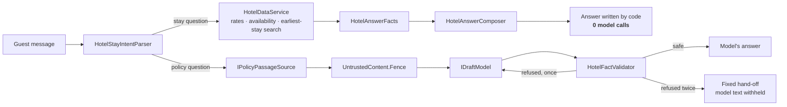

# Grounded Hotel Concierge

**An AI concierge where the language model never states a price.**

[](https://github.com/Babak73314/grounded-hotel-concierge/actions/workflows/ci.yml)

A guest writes to a hotel, in English or Turkish: *"How much is a room from 4 to
7 December for 2 adults?"* or *"What time is breakfast?"*. The first question
has exactly one correct answer, so code computes it and code writes it. The
second needs a language model, which gets the relevant policy text inside a
fence. Its draft then goes through a deterministic check before a guest sees it.

This repository shows that split: deterministic business logic on one side,
model-written text on the other, and tests that keep the boundary where it is.
It needs no cloud account, database, API key or paid licence.

```bash
git clone https://github.com/Babak73314/grounded-hotel-concierge.git
cd grounded-hotel-concierge
dotnet test
dotnet run --project samples/GroundedConcierge.Demo
```

Requires the .NET 10 SDK. `dotnet test` runs 422 tests; none needs a network.

## The two paths



**Commercial turns (dates, prices, availability) never reach the model.**
- The parser reads the guest's dates, party and room type in either language.
  It resolves "next weekend" against the property's clock, not the server's.
- The engine prices every night and adds the nights up. It can also search
  forward for the earliest stay that has a room free on every night.
- The composer writes the answer from the engine's own result object.

The model is not asked to check this answer, and it is not asked to add a
friendly sentence beside it. It is not called at all. A model that is never
asked cannot contradict the availability.

**Policy turns are the model's, under a gate.**
- Relevant passages go to the model inside a fence it cannot break out of.
  The guest's own words go in a second fence.
- The draft is checked for things the concierge must never claim: "booked",
  "held", "charged", "sent", "reception has confirmed".
- A refused draft gets exactly one rewrite, with a note naming the kinds of
  claim that were refused.
- A second refusal replaces the model's text with a fixed hand-off.
- With no passage to ground an answer, the model is not asked at all.

The demo prints which path each turn took and how many model calls it made:

```
Guest: How much is a room from 4 to 7 December for 2 adults?
[Quote · model calls this turn: 0]
For 04.12.2026 to 07.12.2026 (3 nights, 2 adults):
- Garden Room: 2 rooms available, €704 total for 3 nights (average €235 a night).
...

Guest: What time is breakfast?
[Document · model calls this turn: 2 · first draft refused]
Breakfast is served in the garden restaurant from 07:00 to 10:30 and is included in every rate. [breakfast]
```

## Where the code comes from

This is a slice of a private commercial AI platform I build and maintain. In
that platform the same hotel path serves a live bilingual demo behind a real
model and a real search index. For this repository, the deterministic core was
extracted, renamed and trimmed, and its line breaks were made explicit so that
the text is identical on Linux and Windows. What surrounded it there (the model
client, retrieval, persistence, the web UI) is replaced here by small interfaces
with in-memory implementations.

| Part | Files | Origin |
|---|---|---|
| Stay parser (TR/EN) | `HotelStayIntentParser.cs`, `HotelConversationState.cs` | **From the platform** |
| Rate and availability engine | `HotelDataService.cs`, `HotelAvailabilityModel.cs`, `HotelCatalogSnapshot.cs`, `StayQuote.cs`, `HotelServiceCatalog.cs` | **From the platform** |
| Answer composer | `HotelAnswerComposer.cs`, `HotelAnswerFacts.cs`, `HotelPlural.cs`; the fixed guest texts in `GuestMessages.cs` | **From the platform** |
| Validator and gate | `HotelFactValidator.cs`, `HotelAnswerGate.cs` | **From the platform**. The retry note to the model was rewritten for this repository. |
| Untrusted-content fence | `UntrustedContent.cs` | **From the platform**. The reserved-tag list was cut down to this repository's two fences. |
| Turn orchestration | `ConciergeEngine.cs` | *Written for this showcase*. It follows the platform's routing, without its model client, search, persistence and logging. |
| In-memory sources and clocks | `InMemoryHotelCatalogSource`, `InMemoryPolicyPassages` (the passages are invented), `FixedHotelClock`, `SystemHotelClock` | *Written for this showcase*. The `IHotelClock` interface is from the platform. |
| Scripted model | `IDraftModel`, `ScriptedDraftModel` | *Written for this showcase* |
| Architecture tests | everything in `tests/GroundedConcierge.Architecture.Tests` | *Written for this showcase* |
| Other tests | `HotelEngineTests`, `HotelStayIntentParserTests`, `HotelEarliestStayTests`, `HotelCommercialWordingTests`, `HotelOutputGateTests` | **From the platform**, adapted to these projects |
| | `ConciergeEngineTests`, `FenceTests`, `InMemoryPolicyPassagesTests` | *Written for this showcase* |
| Demo | `samples/GroundedConcierge.Demo` | *Written for this showcase* |

The hotel is fictional and so are its rooms, rates and policies.

I develop with AI coding tools under my own review, and I remain responsible for
the architecture, the code quality and every decision in this repository.

## Read these first

1. [`ConciergeEngine.cs`](src/GroundedConcierge.Answering/ConciergeEngine.cs): where a turn takes one path or the other.
2. [`HotelAnswerComposer.cs`](src/GroundedConcierge.Domain/HotelAnswerComposer.cs): the commercial answer, written by code.
3. [`HotelDataService.cs`](src/GroundedConcierge.Domain/HotelDataService.cs): every figure is arithmetic in one class.
4. [`HotelAnswerGate.cs`](src/GroundedConcierge.Answering/HotelAnswerGate.cs): draft → check → one rewrite → withhold, in a fixed order.
5. [`HotelFactValidator.cs`](src/GroundedConcierge.Answering/HotelFactValidator.cs): why "Nothing has been booked" is safe and "Nothing has been booked and your room is confirmed" is not.

## Design decisions worth a look

- **A model that is never asked cannot be wrong.** An allowlist over a model's
  figures cannot see the role a figure plays. It passes "€704/night" when €704
  is the total, and it never sees "every room is available", which has no
  figure at all. So commercial text is not checked. It is written by code.
- **Deterministic across processes and machines.** Pseudo-availability is
  seeded with a hand-written FNV-1a hash. `HashCode.Combine` is salted per
  process and would give a different hotel after every restart. Golden values
  in the tests pin it, and CI runs on Linux and Windows.
- **A total is the sum of the nights, never an average multiplied back up.**
  The average is derived from the total and labelled as an average.
- **Problems are codes.** An unquotable request returns reasons (`TooManyAdults`,
  `PartyTooLarge`, …) and no prices. A price shown next to an error is a price
  somebody will believe.
- **Bounded search.** The earliest-stay search stops at the booking horizon. It
  says how far it looked, and it says "earlier dates were full" only when it
  actually examined earlier dates.
- **Negation is per predicate.** A denial reaches back only to the last
  coordinator ("and", "ve", …), so a safe first clause cannot launder an unsafe
  second one.
- **Narrow fencing.** Only the exact sequences that would close, re-open or
  forge a fence are escaped. Ordinary prose, including "act as" or "ignore",
  is left untouched, because it is the evidence the answer is grounded in.
- **Turkish is not English with other words.** A Turkish numeral takes an
  uninflected noun ("3 gece", never "3 geceler"), and the text tests pin both
  languages exactly.

## Layout and the dependency rule

```
src/
  GroundedConcierge.Domain/      parser, engine, composer, clock: no references, no packages
  GroundedConcierge.Answering/   gate, validator, fence, model seam, engine: references Domain only
samples/
  GroundedConcierge.Demo/        composition root: a scripted console conversation
tests/
  GroundedConcierge.Domain.Tests/
  GroundedConcierge.Answering.Tests/
  GroundedConcierge.Architecture.Tests/
```

The architecture tests read the project files from disk and fail the build if
any of these break:
- the Domain references any project or package;
- the Answering layer references anything but the Domain;
- anything references the demo;
- any package outside the three test packages (`xunit`, its runner and the
  test SDK) appears anywhere. This is what stops a model SDK, a cloud SDK or a
  commercial component from being added quietly;
- the Domain reads the machine clock, the environment, the file system or the
  network, uses randomness, or contains anything asynchronous.

Each rule is also shown failing on a hand-built graph. A rule that has never
been seen to fail proves nothing.

## What this is not

It is not connected to a model. In my platform's live demo `IDraftModel` is a
real model call; here it is `ScriptedDraftModel`, which returns canned drafts
and records every prompt. It books nothing, holds nothing and charges nothing,
and the composed answer says so in every quote. In that demo the catalogue is a
database that staff maintain; here `IHotelCatalogSource` is in memory, and a
property-management system could sit behind the same interface.

## Licence

Copyright (c) 2026 Babak. All rights reserved. See [LICENSE](LICENSE).
The code is published to be read, built and run for evaluation. Any other use
needs written permission.

---

Built by Babak ([Babak73314](https://github.com/Babak73314)). I design
and build AI features in .NET where the model's job is clearly bounded and code
owns the facts.
